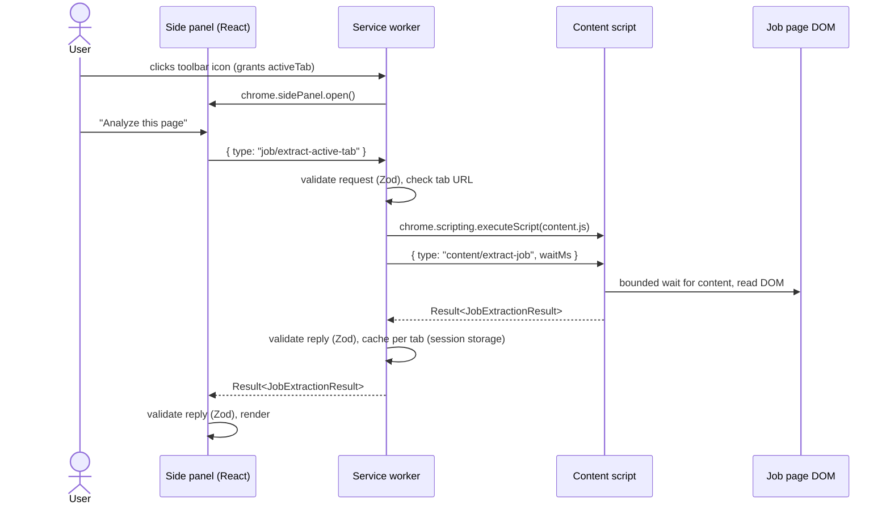
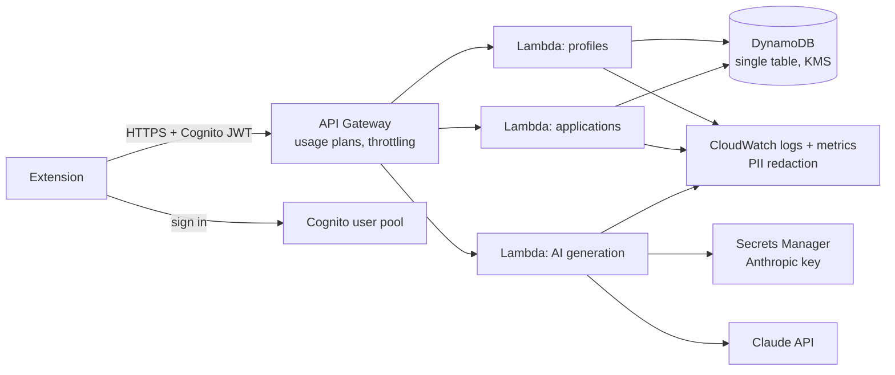

# Architecture

This document describes what exists today (through Phase 3) and the intended shape of later
phases.
Anything marked **planned** has not been built.

## Principles

1. **Human in the loop.** The extension reads and suggests; the user decides. It never submits
   an application, clicks Apply, or answers legal, eligibility or demographic questions.
2. **Deterministic first, AI second.** Structured data and rules run locally; AI (Phase 3) is
   used only where rules cannot do the job, and its output is schema-validated.
3. **Provenance on every value.** Each extracted field records its source and confidence, and a
   field that was not found is reported as missing, never guessed.
4. **Least privilege.** No broad host permissions, no remote code. The only network access is to
   the user's own ApplyPilot API, behind an optional permission, consent and a Generate click.
5. **Verify the model.** AI output is schema-validated and then checked against the profile by
   deterministic code before anyone sees it.

## Workspace layout

| Package                      | Responsibility                                                                | Depends on             |
| ---------------------------- | ----------------------------------------------------------------------------- | ---------------------- |
| `@applypilot/shared`         | Zod schemas (job posting, settings, messages), constants, skill vocabulary    | zod                    |
| `@applypilot/job-extraction` | Pure DOM extraction: takes a `Document` and URL, returns a validated result   | shared                 |
| `@applypilot/resume-parser`  | PDF/DOCX text extraction and deterministic resume parsing                     | shared                 |
| `@applypilot/matching`       | Pure job-to-profile scoring, evidence and truthful suggestions                | shared                 |
| `@applypilot/ai-core`        | AI contracts, versioned prompts, data minimisation, grounding, question rules | shared                 |
| `@applypilot/api`            | Local API (`services/api`): auth, limits, Claude or mock provider             | ai-core, Anthropic SDK |
| `@applypilot/extension`      | MV3 extension: UI, service worker, content script, storage                    | all packages but api   |

Packages are consumed as TypeScript source (`exports: ./src/index.ts`) and bundled by Vite, so
there is no separate build step per package and no stale `dist` folders. Extraction lives in its
own package because it has no Chrome dependency: it is tested against fixture pages in jsdom, and
the same code can later run in a backend or a Node CLI.

The prompt's proposed `packages/ui` and `apps/dashboard` folders are not created yet. They will
be added when there is code to put in them, rather than as empty scaffolding.

## Extension runtime



- **Side panel and options page** are React apps sharing one design system
  (`apps/extension/src/components/ui`). Browser APIs are reached only through an injected
  `AppServices` object, so components are tested without Chrome.
- **Service worker** (`src/background`) is stateless between events, which suits MV3 suspension:
  the only state is in `chrome.storage`. Its message handling lives in `router.ts`, a pure
  function with injected dependencies.
- **Content script** (`src/content`) is injected on demand, never declared in the manifest, and
  guarded against double registration. It is built as a single IIFE because injected scripts
  cannot import chunks.
- **Messaging** (`packages/shared/src/schemas/messages.ts`) is a discriminated union per
  receiver with a response schema per request type. Every hop validates what it receives,
  including replies from the content script, which runs inside an untrusted page.
- **Storage:** settings in `chrome.storage.local` behind `SettingsRepository`, which repairs
  corrupt data field by field; per-tab analyses in `chrome.storage.session`, cleared on
  navigation and tab close; the profile in `chrome.storage.local` behind `ProfileRepository`
  (validated on write, corrupt data reported rather than repaired); uploaded resume files and
  their parsed drafts in IndexedDB behind `ResumeStore`. Applications will use IndexedDB in
  Phase 5.

## Resume parsing and matching (Phase 2)

- `packages/resume-parser`: `extractResumeText` reads PDF (pdf.js legacy build, worker shipped
  as `pdf.worker.min.mjs`, WASM off) or DOCX (mammoth, via its HTML so list items stay bullets);
  `parseResumeText` splits the text into sections and builds a `ParsedResume` (draft profile,
  sections found, warnings); `mergeProfiles` applies a reviewed draft by merge or replace.
- `packages/matching`: `matchJob(job, profile, weights)` is a pure function returning the score,
  coverage, per-component breakdown, per-skill evidence, gaps, items to confirm and suggestions.
- Both run in the side panel page. The service worker and content script are unchanged, so the
  job extraction path from Phase 1 is untouched.

## Job extraction pipeline

`extractJob(document, url)` in `packages/job-extraction/src/extract.ts`:

1. **JSON-LD** (`strategies/json-ld.ts`): schema.org `JobPosting`, including `@graph` containers,
   arrays of types, `MonetaryAmount` salaries and double-encoded HTML descriptions.
2. **Site adapter** (`adapters/`): host-matched, platform-specific selectors. Greenhouse and
   Indeed are implemented. Adapters for pages that list many jobs implement `locate()`: Indeed's
   finds the selected job's details panel (inline, or in its same-origin details frame) and
   checks it against the selection (the `vjk` id, the frame's `jk`, or the highlighted card's
   title). When it returns a scope, **every** strategy below reads only inside it and page-wide
   signals (document title, meta tags, search-page JSON-LD) are skipped; when it returns none,
   or the panel still shows another job, no job fields are extracted and the result says why
   (DECISIONS 035). Other platforms are detected and flagged.
3. **Description analysis** (`strategies/description.ts`, `sections.ts`, `text-signals.ts`): the
   description (from the adapter, JSON-LD or the page) is split into sections by headings and
   bold lead-ins, then mined for skills, experience, work arrangement, employment type, salary,
   education and deadline.
4. **Generic page signals** (`strategies/dom.ts`, `url.ts`): `h1` (skipping site headers,
   navigation and account greetings), meta tags, location elements,
   application form detection, canonical URL and job-ID query parameters.

For each field the first strategy (in that order) that produced a **schema-valid** value wins.
Invalid values are dropped with a warning. A page is called a job posting when it has JSON-LD,
matched an adapter, or shows a title, a substantial description and at least two job signals.

HTML from the page is parsed only into inert documents (`createHTMLDocument`), so scripts and
event handlers in descriptions never execute. Dynamic pages are handled by one throttled
`MutationObserver` with a hard timeout (`wait.ts`); there is no polling loop.

AI-assisted extraction (layer 4 in the product brief) is **not built**. Phase 3 used AI for
drafting instead, where rules cannot do the job; extraction stays deterministic.

## AI integration (Phase 3)

```mermaid
sequenceDiagram
  participant U as User
  participant SP as Side panel
  participant API as ApplyPilot API (127.0.0.1)
  participant C as Claude API
  U->>SP: Allow AI processing, connect API (token, optional host permission)
  U->>SP: Generate (after "What will be sent")
  SP->>SP: buildCandidateContext (no contact details), classify questions
  SP->>API: POST /v1/<task>, Bearer token
  API->>API: Host/Origin checks, Zod validation, sensitive-question filter, daily limit
  API->>C: messages.parse: structured output, adaptive thinking, effort, fallbacks
  C-->>API: JSON matching the task schema
  API-->>SP: TaskResponse (output, model, prompt version, tokens, cost)
  SP->>SP: Zod validation, then grounding review against the local profile
  SP-->>U: Draft with removals and flags; copy or download
```

**Data minimisation** (`packages/ai-core/src/context.ts`). A request carries the job's title,
company, location, description and listed qualifications, and from the profile only the summary,
roles with their bullets, projects, education, certifications and skill names. Email, phone,
location, links, GPA, preferences and salary are never included; the name is included only for
cover letters. Entries are referred to by short refs (`E1`, `P2`) so the model can cite sources
and storage ids never leave the browser.

**Prompts** (`prompts.ts`). One stable system prompt per task with the truthfulness rules and a
version string (`tailor-resume@2026-10-14.1`) that is stored with every draft. The candidate
profile is sent as JSON; the job posting is fenced in `<job_posting>` tags marked as untrusted,
and any closing tag inside the posting is removed so it cannot break out of the fence.

**Provider** (`services/api/src/providers`). `AiProvider.generate(task, request)` has two
implementations. The Claude provider uses `client.beta.messages.parse` with
`output_config.format` (the task's Zod schema), `output_config.effort`, adaptive thinking, and
server-side `fallbacks: "default"`; it checks `stop_reason` for `refusal` and `max_tokens`
before reading output, maps SDK errors to typed API errors, and reports tokens and cost. The
mock provider builds drafts only by reordering and quoting the candidate's own text.

**Grounding** (`grounding.ts`). After schema validation, the extension re-checks every draft
against the profile it holds: bullets must name the original bullets they come from (or are
removed), unknown entry refs and skills outside the skills list are removed, and any number or
known skill the source does not contain is flagged on the exact bullet or paragraph. Screening
answers to questions that should never be drafted are removed even if the model wrote one.

**Sensitive questions** (`screening.ts`). Work authorization, criminal history, age, demographic
questions and legal attestations are "sensitive"; pay, availability, relocation, references and
contact details are "personal". Neither kind is ever sent: the extension filters them before
the request and the API filters again, answering without calling Claude when nothing is left.

**API** (`services/api/src`). `createApi` is a pure `(request) => response` function: bearer
token check (constant-time), routing, Zod validation, the screening filter, a daily request
limit, and a typed error envelope. `http.ts` adapts it to Node's HTTP server, binds to
127.0.0.1 only, rejects Host headers other than localhost (DNS rebinding), allows only
`chrome-extension://` origins, answers CORS and Private Network Access preflights, and caps the
body at 300 KB. Logs contain route, status, duration, model and token counts, never content.

| Endpoint                     | Body                            | Returns                                  |
| ---------------------------- | ------------------------------- | ---------------------------------------- |
| `GET /v1/health`             | none                            | provider, model, requests used and limit |
| `POST /v1/tailor-resume`     | `{ job, candidate }`            | summary, bullets with sources, skills    |
| `POST /v1/cover-letter`      | `{ job, candidate, options }`   | greeting, paragraphs, closing, sources   |
| `POST /v1/screening-answers` | `{ job, candidate, questions }` | answers, plus questions it skipped       |

**Extension** (`apps/extension/src/features/ai`). The AI Tailor view gates on consent, a saved
connection, a non-empty profile and an analyzed job. Each tool shows "What will be sent" with
the exact JSON and a worst-case cost, then the reviewed draft with its model, prompt version,
tokens and cost. The latest draft per task and job is kept in `chrome.storage.local` (30 at
most) and re-reviewed when shown. Nothing is pasted into the page.

## Planned backend (Phase 6)



- REST API with per-route Zod validation and a typed error envelope matching the extension's.
- User-scoped authorization: every DynamoDB key is prefixed with the Cognito `sub`.
- The Phase 3 API handler (`createApi`) moves into the AI Lambda unchanged; the Node HTTP adapter
  is replaced by an API Gateway adapter, the bearer token by Cognito, the in-memory daily limit
  by a DynamoDB counter, and the key moves from `.env` to Secrets Manager.
- Infrastructure in AWS CDK (TypeScript) with separate dev and prod stacks, least-privilege IAM,
  and a budget alarm. Nothing will be deployed without explicit approval.
