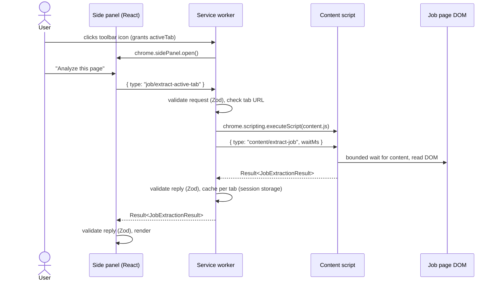
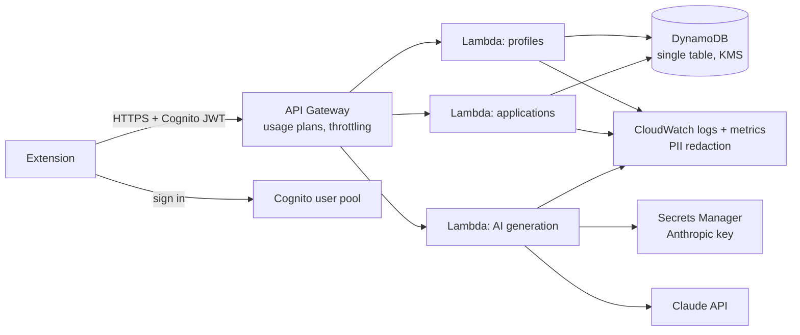

# Architecture

This document describes what exists today (Phase 1) and the intended shape of later phases.
Anything marked **planned** has not been built.

## Principles

1. **Human in the loop.** The extension reads and suggests; the user decides. It never submits
   an application, clicks Apply, or answers legal, eligibility or demographic questions.
2. **Deterministic first, AI second.** Structured data and rules run locally; AI (Phase 3) is
   used only where rules cannot do the job, and its output is schema-validated.
3. **Provenance on every value.** Each extracted field records its source and confidence, and a
   field that was not found is reported as missing, never guessed.
4. **Least privilege.** No broad host permissions, no remote code, and no network access in Phase 1.

## Workspace layout

| Package                      | Responsibility                                                              | Depends on             |
| ---------------------------- | --------------------------------------------------------------------------- | ---------------------- |
| `@applypilot/shared`         | Zod schemas (job posting, settings, messages), constants, skill vocabulary  | zod                    |
| `@applypilot/job-extraction` | Pure DOM extraction: takes a `Document` and URL, returns a validated result | shared                 |
| `@applypilot/extension`      | MV3 extension: UI, service worker, content script, storage                  | shared, job-extraction |

Packages are consumed as TypeScript source (`exports: ./src/index.ts`) and bundled by Vite, so
there is no separate build step per package and no stale `dist` folders. Extraction lives in its
own package because it has no Chrome dependency: it is tested against fixture pages in jsdom, and
the same code can later run in a backend or a Node CLI.

The prompt's proposed `packages/ui`, `apps/dashboard` and `services/api` folders are not created
yet. They will be added when there is code to put in them, rather than as empty scaffolding.

## Extension runtime

- **Side panel and options page** are React apps sharing one design system
  (`apps/extension/src/components/ui`). Browser APIs are reached only through an injected
  `AppServices` object, so components are tested without Chrome.
- **Service worker** (`src/background`) is stateless between events, which suits MV3 suspension:
  the only state is in `chrome.storage`. Its message handling lives in `router.ts`, a pure
  function with injected dependencies.
- **Content script** (`src/content`) is injected on demand, never declared in the manifest, and
  guarded against double registration. It is built as a single IIFE because injected scripts
  cannot import chunks.
- **Messaging** (`packages/shared/src/schemas/messages.ts`) is a discriminated union per
  receiver with a response schema per request type. Every hop validates what it receives,
  including replies from the content script, which runs inside an untrusted page.
- **Storage:** settings in `chrome.storage.local` behind `SettingsRepository`, which repairs
  corrupt data field by field; per-tab analyses in `chrome.storage.session`, cleared on
  navigation and tab close. IndexedDB is planned for larger structured data (profiles, resume
  versions, applications) in Phases 2 and 5.

## Job extraction pipeline

`extractJob(document, url)` in `packages/job-extraction/src/extract.ts`:

1. **JSON-LD** (`strategies/json-ld.ts`): schema.org `JobPosting`, including `@graph` containers,
   arrays of types, `MonetaryAmount` salaries and double-encoded HTML descriptions.
2. **Site adapter** (`adapters/`): host-matched, platform-specific selectors. Greenhouse is
   implemented; other platforms are detected and flagged.
3. **Description analysis** (`strategies/description.ts`, `sections.ts`, `text-signals.ts`): the
   description (from the adapter, JSON-LD or the page) is split into sections by headings and
   bold lead-ins, then mined for skills, experience, work arrangement, employment type, salary,
   education and deadline.
4. **Generic page signals** (`strategies/dom.ts`, `url.ts`): `h1`, meta tags, location elements,
   application form detection, canonical URL and job-ID query parameters.

For each field the first strategy (in that order) that produced a **schema-valid** value wins.
Invalid values are dropped with a warning. A page is called a job posting when it has JSON-LD,
matched an adapter, or shows a title, a substantial description and at least two job signals.

HTML from the page is parsed only into inert documents (`createHTMLDocument`), so scripts and
event handlers in descriptions never execute. Dynamic pages are handled by one throttled
`MutationObserver` with a hard timeout (`wait.ts`); there is no polling loop.

AI-assisted extraction (layer 4 in the product brief) is **planned** for Phase 3 and will only
run when the user has enabled AI processing.

## Planned backend (Phases 3 and 6)

- REST API with per-route Zod validation and a typed error envelope matching the extension's.
- User-scoped authorization: every DynamoDB key is prefixed with the Cognito `sub`.
- AI calls go through a provider interface with prompt versioning, timeouts, bounded retries,
  token accounting and schema-validated JSON output.
- Infrastructure in AWS CDK (TypeScript) with separate dev and prod stacks, least-privilege IAM,
  and a budget alarm. Nothing will be deployed without explicit approval.
