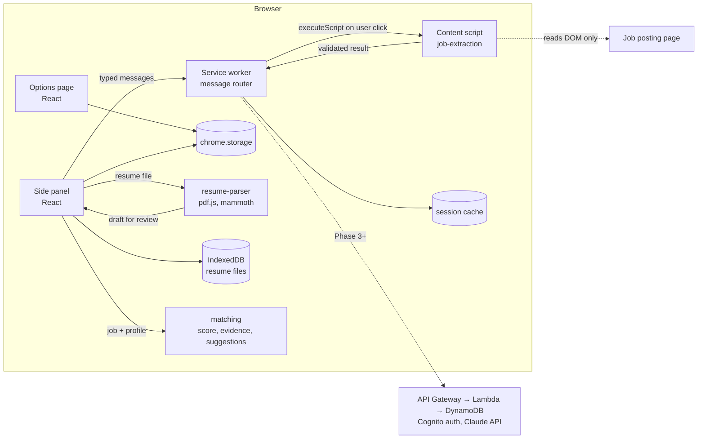

# ApplyPilot AI

**Apply smarter. Apply faster. Stay organized.**

ApplyPilot AI is a Chrome extension (Manifest V3) that acts as a human-in-the-loop job
application copilot. It reads the job posting you are looking at, explains what it found and
where each detail came from, and scores it against your own profile with an explainable match
and truthful resume suggestions. Later phases draft tailored materials, assists with form filling that you approve field by field, and tracks your
applications.

> **Project status: Phase 2 (profile, resume parsing and matching) built and tested, waiting
> for manual approval in Chrome.** AI features, autofill, tracking and the AWS backend are **not
> built yet**, and the extension says so in its UI. See [PROGRESS.md](PROGRESS.md) for the exact,
> verified state.


| Resume review                                                                  | Match with your profile                                                         |
| ------------------------------------------------------------------------------ | ------------------------------------------------------------------------------- |
|  |  |

## Problem

Students and early-career applicants send many applications, each needing the same details
re-typed, a resume tuned to the role, and a way to remember where everything stands. Existing
"auto-apply" bots trade trust for volume: they guess answers, invent qualifications and submit
without review. ApplyPilot takes the opposite approach: deterministic where possible,
explainable everywhere, and nothing is submitted or claimed without the user's approval.

## Features

| Feature                                                                                                         | Status               |
| --------------------------------------------------------------------------------------------------------------- | -------------------- |
| MV3 extension with React side panel, six-section navigation, light/dark themes                                  | Done                 |
| Settings page (theme, AI-processing consent, match weights) with validation                                     | Done                 |
| Local data export and deletion                                                                                  | Done                 |
| Typed, runtime-validated messaging between side panel, service worker and page                                  | Done                 |
| Job extraction: JSON-LD, Greenhouse and Indeed adapters, generic page analysis, per-field source and confidence | Done                 |
| Platform detection for Lever, Workday, SmartRecruiters, Ashby (generic extraction only, flagged in UI)          | Done                 |
| Profile editor (education, experience, skills, certifications, projects, preferences) stored locally            | Done                 |
| Resume upload (PDF, DOCX) parsed on-device, reviewed and corrected before saving, with version history          | Done                 |
| Explainable 0–100 match score with evidence for every matched skill, gaps, and items to check yourself          | Done                 |
| Truthful resume suggestions (never invent skills, numbers or experience)                                        | Done                 |
| Claude-powered tailoring, cover letters, screening answers                                                      | Phase 3, not started |
| Assisted autofill with per-field approval                                                                       | Phase 4, not started |
| Application tracking and analytics                                                                              | Phase 5, not started |
| AWS backend (API Gateway, Lambda, DynamoDB, Cognito, CDK)                                                       | Phase 6, not started |

## Technology

- **Extension:** TypeScript 6, React 19, Vite 8, Tailwind CSS 4, Zustand, React Hook Form, Zod 4,
  Lucide icons, Chrome Side Panel / Scripting / Storage APIs, IndexedDB, pdf.js (PDF) and
  mammoth (DOCX) running locally
- **Quality:** pnpm workspaces, ESLint (typescript-eslint strict type-checked), Prettier, Vitest,
  React Testing Library, Playwright (real Chromium with the built extension), GitHub Actions
- **Planned:** Node.js Lambdas, API Gateway, DynamoDB, Cognito, CloudWatch, AWS CDK, Anthropic Claude API (server-side only)

## Architecture



More detail, including the extraction pipeline and planned AWS design, is in
[ARCHITECTURE.md](ARCHITECTURE.md). Design decisions and their reasoning are in
[DECISIONS.md](DECISIONS.md).

```
apps/extension/          Chrome extension (side panel, options, service worker, content script)
packages/shared/         Zod schemas, message contract, constants shared by every package
packages/job-extraction/ DOM-only, deterministic job extraction (JSON-LD, adapters, text signals)
packages/resume-parser/  PDF/DOCX text extraction and deterministic resume parsing into a profile draft
packages/matching/       Explainable job-to-profile scoring and truthful suggestions (pure functions)
tests/fixtures/jobs/     Fictional job pages used by unit and e2e tests
tests/fixtures/resumes/  A fictional resume as text, PDF and DOCX (generated by generate.py)
tests/e2e/               Playwright tests that load the built extension into Chromium
docs/                    Screenshots and the privacy policy draft
```

## Local setup

Requirements: Node.js 22.13 or newer, pnpm 10 (`corepack enable` provides it), Chrome 116 or newer.

```bash
pnpm install
pnpm build            # outputs apps/extension/dist
```

Load it in Chrome (step-by-step guide with a test checklist: [docs/INSTALL-CHROME.md](docs/INSTALL-CHROME.md)):

1. Open `chrome://extensions` and turn on **Developer mode**.
2. Click **Load unpacked** and choose `apps/extension/dist`.
3. Pin ApplyPilot AI, open a job posting, and click the toolbar icon (or press Alt+Shift+A).
4. In the side panel, open **Profile** and upload your resume (or fill the profile in by hand),
   check the parsed result, and save it.
5. On a job posting, click **Analyze this page** to see the job details and your match.

Clicking the toolbar icon is what grants the extension access to the current page (`activeTab`).
If you switch tabs, click the icon again on the new tab before analyzing.

For development, `pnpm dev` rebuilds on change; reload the extension in `chrome://extensions`
after each build.

### Demo

Serve the fixtures with `node tests/e2e/fixture-server.mjs` and open
`http://127.0.0.1:4173/jobs/json-ld-cloud-intern.html` or
`http://127.0.0.1:4173/jobs/generic-devops-role.html`, then analyze them from the side panel.

## Environment variables

None are needed for Phases 1 and 2. See [.env.example](.env.example). Variables prefixed with `VITE_`
are embedded into the extension bundle, so secrets must never use that prefix; the Anthropic API
key will live only in the backend's secret store (Phase 3+).

## Testing

```bash
pnpm test            # unit + integration (Vitest, jsdom)
pnpm test:coverage   # with V8 coverage
pnpm test:e2e        # builds the e2e variant and runs Playwright in Chromium
pnpm verify          # typecheck, lint, format check, tests, production build
```

The e2e build is identical to the release build except that it is granted host access to
`http://127.0.0.1`, standing in for the toolbar click that automation cannot perform. If your
Playwright version does not match an installed Chromium, set `CHROMIUM_PATH` to a Chromium
binary.

## Security and privacy

Minimal permissions (`activeTab`, `scripting`, `sidePanel`, `storage`), no host permissions, no
remote code, strict CSP, runtime validation of every message, and no network requests. Resumes are read and parsed on your device and are never uploaded.
See [SECURITY.md](SECURITY.md) and the [privacy policy draft](docs/PRIVACY.md).

## AWS, API and deployment

The backend has not been built. ARCHITECTURE.md describes the planned serverless design.
Deployment instructions, API documentation and a cost estimate will be added with Phase 6, and
nothing will be deployed without explicit approval.

## How the match score works

The score is a weighted average of five parts, using the weights from Settings (defaults:
required skills 35, experience 25, education 15, preferred skills 15, job preferences 10).

- **Skills:** a skill counts when your profile shows it anywhere (skills list, a job, a project,
  a certification or coursework), and the card says where. A more specific skill counts for the
  general one (AWS Lambda counts as AWS); a related one gets half credit (AWS for Amazon EC2).
  "One of Python, Go or Java" is one requirement.
- **Experience:** years from your dated roles, with overlaps counted once.
- **Education:** the lowest degree the posting accepts, with degrees in progress accepted for
  student roles.
- **Job preferences:** work arrangement, employment type and preferred locations, only if you set
  them.

A part the posting does not mention is **left out** rather than counted for or against you, and
the card shows how much of the weight was compared. Requirements a program should not judge,
such as work authorization, are listed under "Check these yourself". The score is a heuristic,
not a hiring prediction.

## Known limitations

- Scanned (image-only) PDFs cannot be read (no OCR); two-column PDF layouts may mix lines, which
  you can fix on the review screen; `.doc` files and non-English section headings are not
  supported.
- Only Greenhouse boards and Indeed (search results with a selected job, and job pages) have
  dedicated adapters. Lever, Workday, SmartRecruiters and Ashby pages are detected but use
  generic extraction, and their results may be incomplete.
- Greenhouse boards embedded in an employer's site run in a cross-origin iframe, which is not read.
- The Greenhouse and Indeed adapters were built against fixtures modeled on public markup. The
  Indeed adapter fixes a bug reported from a live Indeed page but has not been re-checked there
  yet.
- Skill detection uses a fixed vocabulary of 53 technologies, so it can miss niche tools.
- A bare `$` salary is reported with an unknown currency rather than assumed to be USD.
- Analysis requires a toolbar click per tab because the extension does not request broad host
  access.

## Roadmap

Phases 3 to 7 are listed in [PROGRESS.md](PROGRESS.md#next-recommended-steps): server-side
Claude integration, user-approved autofill,
tracking and analytics, AWS infrastructure with CDK, and production hardening.

## Interview notes

What to be able to explain about each phase, and resume bullets limited to verified work:
[docs/INTERVIEW-NOTES.md](docs/INTERVIEW-NOTES.md).

## Contributing

See [CONTRIBUTING.md](CONTRIBUTING.md).
