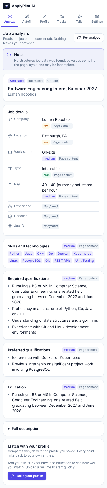
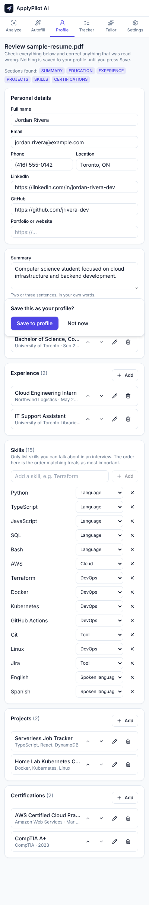
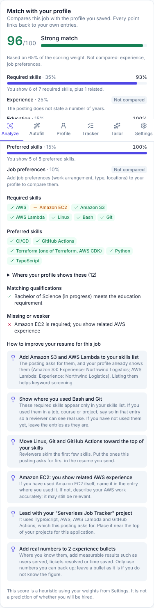
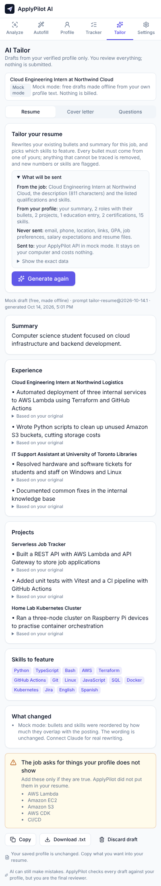
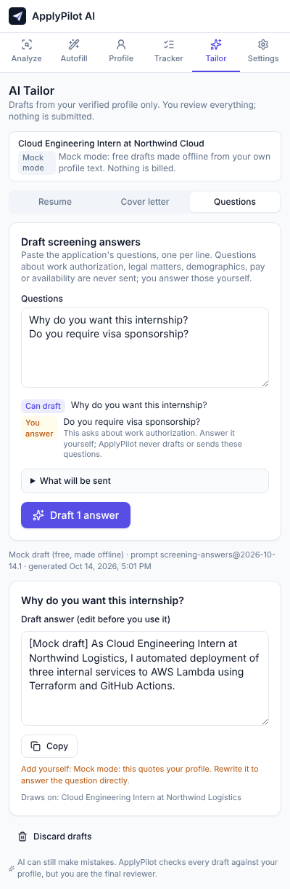
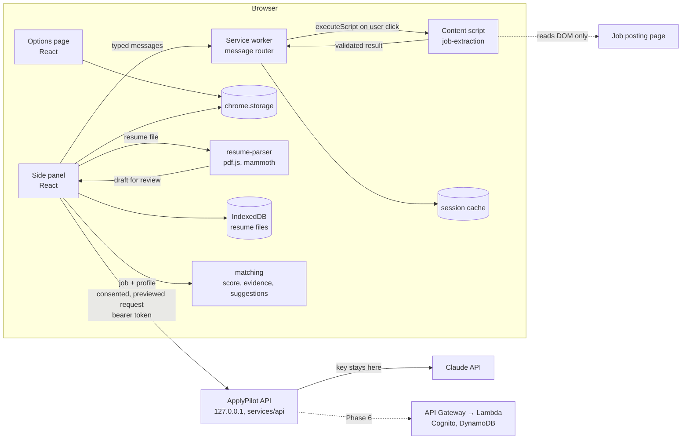

# ApplyPilot AI

**Apply smarter. Apply faster. Stay organized.**

ApplyPilot AI is a Chrome extension (Manifest V3) that acts as a human-in-the-loop job
application copilot. It reads the job posting you are looking at, explains what it found and
where each detail came from, and scores it against your own profile with an explainable match
and truthful resume suggestions. With your consent it drafts a tailored resume, a cover letter
and screening answers with Claude, checked against your profile so nothing is invented. Later
phases add form filling that you approve field by field, and application tracking.

> **Project status: Phase 3 (Claude integration, tailoring, cover letters, screening drafts)
> built and tested, waiting for manual approval in Chrome.** Autofill, tracking and the AWS
> backend are **not built yet**, and the extension says so in its UI. See
> [PROGRESS.md](PROGRESS.md) for the exact, verified state.



| Resume review                                                                  | Match with your profile                                                         |
| ------------------------------------------------------------------------------ | ------------------------------------------------------------------------------- |
|  |  |

| AI tailoring (mock mode shown)                                                 | Screening questions                                                        |
| ------------------------------------------------------------------------------ | -------------------------------------------------------------------------- |
|  |  |

## Problem

Students and early-career applicants send many applications, each needing the same details
re-typed, a resume tuned to the role, and a way to remember where everything stands. Existing
"auto-apply" bots trade trust for volume: they guess answers, invent qualifications and submit
without review. ApplyPilot takes the opposite approach: deterministic where possible,
explainable everywhere, and nothing is submitted or claimed without the user's approval.

## Features

| Feature                                                                                                         | Status               |
| --------------------------------------------------------------------------------------------------------------- | -------------------- |
| MV3 extension with React side panel, six-section navigation, light/dark themes                                  | Done                 |
| Settings page (theme, AI-processing consent, match weights) with validation                                     | Done                 |
| Local data export and deletion                                                                                  | Done                 |
| Typed, runtime-validated messaging between side panel, service worker and page                                  | Done                 |
| Job extraction: JSON-LD, Greenhouse and Indeed adapters, generic page analysis, per-field source and confidence | Done                 |
| Platform detection for Lever, Workday, SmartRecruiters, Ashby (generic extraction only, flagged in UI)          | Done                 |
| Profile editor (education, experience, skills, certifications, projects, preferences) stored locally            | Done                 |
| Resume upload (PDF, DOCX) parsed on-device, reviewed and corrected before saving, with version history          | Done                 |
| Explainable 0–100 match score with evidence for every matched skill, gaps, and items to check yourself          | Done                 |
| Truthful resume suggestions (never invent skills, numbers or experience)                                        | Done                 |
| Local ApplyPilot API that holds the Claude key server-side, with a free offline mock mode                       | Done                 |
| AI resume tailoring, cover letters and screening answer drafts (Claude, structured outputs, versioned prompts)  | Done                 |
| Grounding checks on every AI draft: untraceable content removed, new numbers and skills flagged                 | Done                 |
| Sensitive screening questions (legal, eligibility, demographic, pay, availability) never sent to AI             | Done                 |
| Assisted autofill with per-field approval                                                                       | Phase 4, not started |
| Application tracking and analytics                                                                              | Phase 5, not started |
| AWS backend (API Gateway, Lambda, DynamoDB, Cognito, CDK)                                                       | Phase 6, not started |

## Technology

- **Extension:** TypeScript 6, React 19, Vite 8, Tailwind CSS 4, Zustand, React Hook Form, Zod 4,
  Lucide icons, Chrome Side Panel / Scripting / Storage APIs, IndexedDB, pdf.js (PDF) and
  mammoth (DOCX) running locally
- **Quality:** pnpm workspaces, ESLint (typescript-eslint strict type-checked), Prettier, Vitest,
  React Testing Library, Playwright (real Chromium with the built extension), GitHub Actions
- **AI:** Anthropic Claude (Claude Opus 5.5) through the official `@anthropic-ai/sdk`, called only
  from the local ApplyPilot API (`services/api`, Node.js), with structured outputs and Zod
- **Planned:** Node.js Lambdas, API Gateway, DynamoDB, Cognito, CloudWatch, AWS CDK

## Architecture



More detail, including the extraction pipeline and planned AWS design, is in
[ARCHITECTURE.md](ARCHITECTURE.md). Design decisions and their reasoning are in
[DECISIONS.md](DECISIONS.md).

```
apps/extension/          Chrome extension (side panel, options, service worker, content script)
packages/shared/         Zod schemas, message contract, constants shared by every package
packages/job-extraction/ DOM-only, deterministic job extraction (JSON-LD, adapters, text signals)
packages/resume-parser/  PDF/DOCX text extraction and deterministic resume parsing into a profile draft
packages/matching/       Explainable job-to-profile scoring and truthful suggestions (pure functions)
packages/ai-core/        AI contracts, versioned prompts, data minimisation, grounding checks, question rules
services/api/            Local ApplyPilot API: Claude (or mock) provider, auth, limits; Lambda-portable handler
tests/fixtures/jobs/     Fictional job pages used by unit and e2e tests
tests/fixtures/resumes/  A fictional resume as text, PDF and DOCX (generated by generate.py)
tests/e2e/               Playwright tests that load the built extension into Chromium
docs/                    Screenshots and the privacy policy draft
```

## Local setup

Requirements: Node.js 22.13 or newer, pnpm 10 (`corepack enable` provides it), Chrome 116 or newer.

```bash
pnpm install
pnpm build            # outputs apps/extension/dist
```

Load it in Chrome (step-by-step guide with a test checklist: [docs/INSTALL-CHROME.md](docs/INSTALL-CHROME.md)):

1. Open `chrome://extensions` and turn on **Developer mode**.
2. Click **Load unpacked** and choose `apps/extension/dist`.
3. Pin ApplyPilot AI, open a job posting, and click the toolbar icon (or press Alt+Shift+A).
4. In the side panel, open **Profile** and upload your resume (or fill the profile in by hand),
   check the parsed result, and save it.
5. On a job posting, click **Analyze this page** to see the job details and your match.

### AI drafts (optional)

The AI tools need the local ApplyPilot API, which keeps the Claude API key off the extension:

```bash
pnpm api:setup   # once: creates services/api/.env with an access token, in free mock mode
pnpm api         # starts the API on http://127.0.0.1:8787
```

In the extension, turn on **Allow AI processing**, then paste the token under **Settings → AI
connection** and press **Save and test connection** (Chrome asks once for access to the API on
your computer). Mock mode drafts by reordering and quoting your own text, for free. To use
Claude, set `APPLYPILOT_PROVIDER=anthropic` and `ANTHROPIC_API_KEY` in `services/api/.env` and
restart the API; requests are then billed to your Anthropic account (see
[cost](#ai-costs)).

Clicking the toolbar icon is what grants the extension access to the current page (`activeTab`).
If you switch tabs, click the icon again on the new tab before analyzing.

For development, `pnpm dev` rebuilds on change; reload the extension in `chrome://extensions`
after each build.

### Demo

Serve the fixtures with `node tests/e2e/fixture-server.mjs` and open
`http://127.0.0.1:4173/jobs/json-ld-cloud-intern.html` or
`http://127.0.0.1:4173/jobs/generic-devops-role.html`, then analyze them from the side panel.

## Environment variables

The extension needs none. The local API reads `services/api/.env` (created by `pnpm api:setup`,
git-ignored):

| Variable                     | Default           | Purpose                                                    |
| ---------------------------- | ----------------- | ---------------------------------------------------------- |
| `APPLYPILOT_LOCAL_TOKEN`     | (required)        | Shared secret the extension sends; at least 24 characters  |
| `APPLYPILOT_PROVIDER`        | `mock`            | `mock` (free, offline) or `anthropic` (Claude, billed)     |
| `ANTHROPIC_API_KEY`          | none              | Needed only for `anthropic`; never sent to the extension   |
| `APPLYPILOT_MODEL`           | `claude-opus-5-5` | Claude model                                               |
| `APPLYPILOT_EFFORT`          | `medium`          | Thinking effort: `low`, `medium`, `high`, `xhigh`, `max`   |
| `APPLYPILOT_DAILY_LIMIT`     | `25`              | Generation requests allowed per day                        |
| `APPLYPILOT_PORT`            | `8787`            | Port on 127.0.0.1                                          |
| `APPLYPILOT_ALLOWED_ORIGINS` | any extension     | Comma-separated `chrome-extension://<id>` origins to allow |

Variables prefixed with `VITE_` are embedded into the extension bundle, so secrets must never use
that prefix. `pnpm check:bundle` fails the build if a key or a direct Claude call appears in it.

### AI costs

Mock mode costs nothing. With Claude Opus 5.5 ($4 per million input tokens, $20 per million
output tokens), a request sends roughly 3,000–8,000 input tokens and uses up to 10,000–12,000
output tokens including thinking, so one draft costs about $0.05–$0.25 and rarely more than $0.30
(output is capped per task; a very long profile and posting add input cost). The "What will be sent" panel shows the upper bound before each request, each draft shows
its actual tokens and cost, and the daily limit (25 by default) caps a runaway day at roughly
$7–$8.

## Testing

```bash
pnpm test            # unit + integration (Vitest, jsdom)
pnpm test:coverage   # with V8 coverage
pnpm test:e2e        # builds the e2e variant and runs Playwright in Chromium
pnpm verify          # typecheck, lint, format check, tests, production build, bundle secret check
```

The e2e build is identical to the release build except that it is granted host access to
`http://127.0.0.1`, standing in for the toolbar click that automation cannot perform. Playwright
also starts the real local API in mock mode, so the AI flow is tested end to end without an API
key or any cost. The Claude provider is tested by running the real SDK against a local fake of
the Messages API. If your
Playwright version does not match an installed Chromium, set `CHROMIUM_PATH` to a Chromium
binary.

## Security and privacy

Minimal permissions (`activeTab`, `scripting`, `sidePanel`, `storage`), no host permissions
except optional access to `127.0.0.1`/`localhost` for the local API, no remote code, strict CSP,
and runtime validation of every message and API response. Resumes are read and parsed on your
device and are never uploaded. AI requests happen only with consent, after a preview, when you
press Generate, and never include your contact details.
See [SECURITY.md](SECURITY.md) and the [privacy policy draft](docs/PRIVACY.md).

## AWS, API and deployment

The ApplyPilot API runs locally for now (`pnpm api`). Its endpoints (`GET /v1/health`,
`POST /v1/tailor-resume`, `/v1/cover-letter`, `/v1/screening-answers`) are documented in
[ARCHITECTURE.md](ARCHITECTURE.md#ai-integration-phase-3). The handler is a pure function so the
same code can run on AWS Lambda in Phase 6. Nothing is deployed to AWS without explicit approval.

## How the match score works

The score is a weighted average of five parts, using the weights from Settings (defaults:
required skills 35, experience 25, education 15, preferred skills 15, job preferences 10).

- **Skills:** a skill counts when your profile shows it anywhere (skills list, a job, a project,
  a certification or coursework), and the card says where. A more specific skill counts for the
  general one (AWS Lambda counts as AWS); a related one gets half credit (AWS for Amazon EC2).
  "One of Python, Go or Java" is one requirement.
- **Experience:** years from your dated roles, with overlaps counted once.
- **Education:** the lowest degree the posting accepts, with degrees in progress accepted for
  student roles.
- **Job preferences:** work arrangement, employment type and preferred locations, only if you set
  them.

A part the posting does not mention is **left out** rather than counted for or against you, and
the card shows how much of the weight was compared. Requirements a program should not judge,
such as work authorization, are listed under "Check these yourself". The score is a heuristic,
not a hiring prediction.

## Known limitations

- Scanned (image-only) PDFs cannot be read (no OCR); two-column PDF layouts may mix lines, which
  you can fix on the review screen; `.doc` files and non-English section headings are not
  supported.
- Only Greenhouse boards and Indeed (search results with a selected job, and job pages) have
  dedicated adapters. Lever, Workday, SmartRecruiters and Ashby pages are detected but use
  generic extraction, and their results may be incomplete.
- Greenhouse boards embedded in an employer's site run in a cross-origin iframe, which is not read.
- The Greenhouse and Indeed adapters were built against fixtures modeled on public markup. The
  Indeed adapter fixes a bug reported from a live Indeed page but has not been re-checked there
  yet.
- Skill detection uses a fixed vocabulary of 53 technologies, so it can miss niche tools.
- A bare `$` salary is reported with an unknown currency rather than assumed to be USD.
- Analysis requires a toolbar click per tab because the extension does not request broad host
  access.
- AI features need the local API running on the same computer; there is no hosted service yet.
- Grounding checks catch new numbers and known skills, not every possible invented claim (for
  example numbers written as words). Every draft is for you to review and edit.
- Screening questions are pasted in by hand; reading them from the form comes with autofill in
  Phase 4.

## Roadmap

Phases 4 to 7 are listed in [PROGRESS.md](PROGRESS.md#next-recommended-steps): user-approved
autofill, tracking and analytics, AWS infrastructure with CDK, and production hardening.

## Interview notes

What to be able to explain about each phase, and resume bullets limited to verified work:
[docs/INTERVIEW-NOTES.md](docs/INTERVIEW-NOTES.md).

## Contributing

See [CONTRIBUTING.md](CONTRIBUTING.md).
