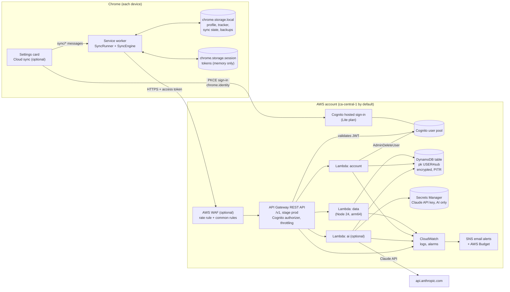

# ApplyPilot Cloud on AWS (Phase 6)

ApplyPilot Cloud is the optional backend for signing in and syncing between browsers. It is
defined in code with the AWS CDK (`infra/`), and every part of it also runs on your own computer
with local stand-ins, so you can build and test it without an AWS account.

> **Status (v0.6.0): built and tested locally. Nothing has been deployed to AWS.** Deploying
> needs the owner's explicit approval. The steps are below so that approval can be informed.

## What syncs, and what never leaves the browser

| Synced (when you turn it on)                                                   | Never uploaded                          |
| ------------------------------------------------------------------------------ | --------------------------------------- |
| Profile (contact details, work history, education, skills)                     | Resume files (PDF and Word)             |
| Tracked applications, with their status history, notes and follow-up reminders | AI drafts, settings, the local AI token |
|                                                                                | Cached page analyses                    |

Sync is off until you connect, sign in, and turn on the switch in Settings. The extension works
fully without it, as it did in Phases 1 to 5.

## Architecture



### Request path

1. **Sign-in.** The extension opens Cognito's hosted page with
   `chrome.identity.launchWebAuthFlow`, using the authorization code flow with PKCE. The password
   is typed on Cognito's page, never in the extension. The extension exchanges the one-time code
   and its PKCE verifier for tokens, and keeps them in `chrome.storage.session` (memory only,
   cleared when the browser closes, unreadable by content scripts).
2. **Every API call** carries the access token. API Gateway's Cognito authorizer rejects missing,
   expired or foreign tokens before any Lambda runs. The Lambda verifies the token again
   (`aws-jwt-verify`: signature, issuer, `token_use=access`, `client_id`) and takes the user id
   only from the token's `sub`. No request can name another user: every DynamoDB key is built
   from `USER#<sub>`.
3. **Sync.** The service worker pulls changes since its last cursor, merges three ways (last
   synced copy, this browser, the cloud), and pushes with the version each change was based on.
   DynamoDB conditional writes refuse anything that would overwrite a newer copy.

### AWS resources (from `infra/lib/applypilot-stack.ts`)

| Resource                       | Configuration                                                                                                                                                                                                   | Why                                                                     |
| ------------------------------ | --------------------------------------------------------------------------------------------------------------------------------------------------------------------------------------------------------------- | ----------------------------------------------------------------------- |
| DynamoDB table                 | On-demand, single table, `pk`/`sk`, sparse LSI `byChange`, TTL, AWS-managed encryption at rest, point-in-time recovery, deletion protection, retained on stack delete                                           | Pay per request; per-user partitions; change feed for sync; recoverable |
| Cognito user pool              | Lite plan, email sign-in, self sign-up with email verification, 12+ character passwords with all character classes, optional TOTP MFA, deletion protection                                                      | Free under 10,000 monthly active users                                  |
| Cognito app client             | Public client (no secret), code flow only, scopes `openid email`, callback only to `https://<extension-id>.chromiumapp.org/`, user-existence errors hidden, token revocation on, 1 h access token, 30 d refresh | Extensions cannot keep secrets; PKCE protects the code                  |
| API Gateway REST API           | Stage `prod`, throttling 20 requests/s (burst 40), CORS only for the extension origin, JSON error responses, access logs without IP addresses, execution logs at ERROR with data tracing off                    | Rate limiting and a cost ceiling; no personal data in logs              |
| Lambda `data`, `account`, `ai` | Node.js 24 on arm64, one role per function with only the DynamoDB actions it uses, 30-day log retention, esbuild bundles                                                                                        | Least privilege; arm64 is cheaper                                       |
| Secrets Manager                | Holds the Claude API key, read only by the `ai` function. Created only with `enableAi=true`                                                                                                                     | No keys in the extension or in code                                     |
| CloudWatch alarms              | API 5xx, API 4xx spike, errors per function                                                                                                                                                                     | Notice failures and abuse                                               |
| SNS topic + AWS Budget         | Email alerts, monthly budget (default USD 5) with alerts at 80% of actual spend and 100% of forecast spend. Created only when `alertEmail` is set                                                               | Find out about charges early                                            |
| AWS WAF (optional)             | Rate rule (500 requests per 5 minutes per IP) and AWS common rules. `enableWaf=true`                                                                                                                            | Extra abuse protection, costs about USD 7/month                         |

`cdk synth` runs [cdk-nag](https://github.com/cdklabs/cdk-nag) AWS Solutions checks; the stack
passes with each remaining exception acknowledged and justified in code (for example, the
public health endpoint has no authorizer by design).

### API (version 1)

All routes except health need a Cognito access token. Errors are always
`{"error": {"code", "message", "requestId"}}`.

| Method and path                                                      | Purpose                                                 |
| -------------------------------------------------------------------- | ------------------------------------------------------- |
| `GET /v1/health`                                                     | Liveness and version                                    |
| `GET /v1/account`                                                    | Account summary and limits                              |
| `GET /v1/account/export`                                             | Everything stored for this account, as JSON             |
| `DELETE /v1/account/data`                                            | Delete all cloud data (keeps the account)               |
| `DELETE /v1/account`                                                 | Delete cloud data and the Cognito user                  |
| `GET`, `PUT`, `DELETE /v1/profile`                                   | Profile                                                 |
| `GET /v1/applications`, `GET`, `PUT`, `DELETE /v1/applications/{id}` | Tracked applications                                    |
| `GET /v1/applications/{id}/history`                                  | Status history                                          |
| `POST /v1/applications/{id}/status`                                  | Change status (adds a history entry)                    |
| `POST /v1/applications/{id}/notes`, `DELETE …/notes/{noteId}`        | Notes                                                   |
| `PUT /v1/applications/{id}/follow-up`                                | Follow-up reminder                                      |
| `GET /v1/sync/changes?since=&page=`                                  | Changes since a cursor, paged                           |
| `POST /v1/sync/push`                                                 | Up to 50 changes, each with the version it was based on |
| `POST /v1/ai/*` (optional)                                           | The Phase 3 AI tasks, served from the cloud             |

Every body is validated with the same zod schemas the extension uses (`packages/sync`), with a
1 MB request limit and a 300 KB limit per stored item. Limits per user: 120 requests per minute,
1,000 applications, and a daily AI quota.

## Conflict handling and data-loss safeguards

| Situation                                                     | What happens                                                                                                                                   |
| ------------------------------------------------------------- | ---------------------------------------------------------------------------------------------------------------------------------------------- |
| Different fields changed on two devices                       | Merged automatically: notes and status history are combined, other fields take whichever side changed                                          |
| The same field changed on two devices                         | Parked as a conflict. Settings shows it; you pick "Keep this browser's copy" or "Use the cloud copy". Neither copy is touched until you choose |
| Edited on one device, deleted on the other                    | A conflict, never a silent deletion                                                                                                            |
| Sync would delete more than 5 records (either direction)      | Sync pauses and asks first                                                                                                                     |
| The cloud changes or deletes anything already in this browser | A backup is taken first. The last two backups can be restored from Settings                                                                    |
| You edit while sync runs                                      | The sync write is refused and retried, so your edit wins and nothing is lost                                                                   |
| Cloud data deleted from another device                        | This browser uploads nothing and asks: upload this browser's data again, or turn sync off                                                      |
| Another device wrote between pull and push                    | The cloud refuses the stale write (conditional put); the engine re-reads and merges, up to 3 rounds                                            |
| Unreadable local entries (corrupt or from a newer version)    | Never synced, changed or dropped                                                                                                               |

## Test everything locally (no AWS account, no charges)

```bash
pnpm install
pnpm verify          # typecheck, lint, format, all unit and integration tests, build, bundle check
pnpm test:e2e        # real Chromium, including the two-browser sync test
```

What runs where:

- `packages/sync` tests: merge rules and the sync engine against an in-memory cloud.
- `services/api` tests: the real cloud API code against **dynalite** (an in-memory DynamoDB),
  with RS256 tokens shaped like Cognito's: rejected tokens (expired, wrong issuer, wrong client,
  ID token instead of access token, unsigned, tampered, other key), user isolation, CRUD,
  validation, size limits, sync paging and conflicts, export, deletion, rate limits, and logs
  without personal data. Also the Lambda handlers and a two-device sync over HTTP.
- `infra` tests: the synthesized CloudFormation (encryption, PITR, least-privilege IAM,
  authorizer on every route, throttling, log retention, CORS) and cdk-nag on two configurations.
- `apps/extension` tests: PKCE sign-in, token refresh and sign-out; local data writes, backups
  and restore; the sync runner; the Settings card.
- `tests/e2e/cloud-sync.spec.ts`: two Chromium browsers with the extension create an account,
  sign in through the real `chrome.identity` flow, sync records both ways, then delete cloud data
  and check the other browser pauses.

### Try it by hand in Chrome

1. `pnpm cloud:local` (ApplyPilot Cloud on `http://127.0.0.1:8788`, with local Cognito and
   DynamoDB stand-ins; data kept in `services/api/.local-cloud/`).
2. In the extension: Settings > **Cloud sync (optional)** > **Use local test server** > Allow.
3. **Sign in or create account**: a Chrome window opens with the local sign-in page. Create an
   account (any email; 12+ character password).
4. Turn on **Sync profile and tracker**. Load the same unpacked extension in a second Chrome
   profile, sign in with the same account, and watch records appear.

## Deploying to AWS (only with the owner's approval)

Prerequisites: an AWS account with billing alerts, the AWS CLI signed in with an IAM Identity
Center user (not the root user), Node 22+, pnpm.

```bash
# 1. Pick names. The domain prefix must be globally unique; the extension id is
#    shown on chrome://extensions (Developer mode). An unpacked extension's id
#    depends on its folder, so keep the folder where it is.
export EXT_ID=abcdefghijklmnopabcdefghijklmnop
export PREFIX=applypilot-yourname

# 2. Review what would be created. Neither command creates anything.
pnpm --filter @applypilot/infra synth -c extensionIds=$EXT_ID -c authDomainPrefix=$PREFIX \
  -c alertEmail=you@example.com
pnpm --filter @applypilot/infra diff  -c extensionIds=$EXT_ID -c authDomainPrefix=$PREFIX \
  -c alertEmail=you@example.com

# 3. One-time per account and region: creates the CDK staging bucket and roles.
npx cdk bootstrap aws://<account-id>/ca-central-1

# 4. Deploy (asks to confirm IAM changes).
pnpm --filter @applypilot/infra deploy -c extensionIds=$EXT_ID -c authDomainPrefix=$PREFIX \
  -c alertEmail=you@example.com
```

Then confirm the SNS email subscription, and paste the stack outputs `ApiUrl`, `AuthUrl` and
`ClientId` into Settings > Cloud sync.

Options (all `-c key=value`): `region` (default `ca-central-1`), `monthlyBudgetUsd` (default 5),
`enableWaf=true`, `enableAi=true` with `aiProvider=anthropic` (then put the Claude API key into
the created secret with `aws secretsmanager put-secret-value`; until then the AI function uses
the mock provider), `aiDailyLimit` (default 25 per user).

Safe-deployment checklist:

- Run `diff` first and read every IAM and security group change.
- Set `alertEmail` so the budget and alarms reach you.
- Keep `enableAi=false` until you want paid Claude calls.
- The table and user pool are **retained** and deletion-protected: `cdk destroy` leaves them,
  so data is not lost by accident. To remove them, turn off deletion protection in the console
  and delete them by hand.
- To roll back a bad Lambda release, redeploy the previous commit.

## Monthly cost estimate

Prices are AWS list prices checked on 2026-10-22 (mostly us-east-1; ca-central-1 is similar or a
little higher). Always confirm with the [AWS Pricing Calculator](https://calculator.aws/) before
deploying.

| Service                                  | Price                                                                                                                  | Personal use (1 to 5 users, ~3,000 requests per user per month) |
| ---------------------------------------- | ---------------------------------------------------------------------------------------------------------------------- | --------------------------------------------------------------- |
| API Gateway REST                         | USD 3.50 per million requests; 1 M free per month for 12 months                                                        | USD 0.00 to 0.05                                                |
| Lambda (arm64)                           | USD 0.20 per million requests + compute; 1 M requests and 400,000 GB-s free every month                                | USD 0.00                                                        |
| DynamoDB on-demand                       | ~USD 0.625 per million writes, ~USD 0.125 per million reads, USD 0.25/GB-month storage; 25 GB storage free every month | USD 0.00                                                        |
| DynamoDB point-in-time recovery          | ~USD 0.20 per GB-month                                                                                                 | USD 0.00 to 0.01 (data is a few MB)                             |
| Cognito Lite                             | 10,000 monthly active users free (does not expire)                                                                     | USD 0.00                                                        |
| CloudWatch                               | Logs USD 0.50/GB ingested; alarms USD 0.10 each after 10 free                                                          | USD 0.00 to 0.05                                                |
| SNS email, AWS Budgets                   | First 1,000 emails and 2 budgets free                                                                                  | USD 0.00                                                        |
| CDK bootstrap bucket                     | S3 storage for deployment files                                                                                        | about USD 0.01                                                  |
| **Default total**                        |                                                                                                                        | **about USD 0.00 to 0.15 per month**                            |
| Secrets Manager (only `enableAi=true`)   | USD 0.40 per secret per month + USD 0.05 per 10,000 calls                                                              | + USD 0.40                                                      |
| Claude API (only `aiProvider=anthropic`) | Per token, billed by Anthropic, capped by the daily per-user AI limit                                                  | + usage                                                         |
| AWS WAF (only `enableWaf=true`)          | USD 5 per web ACL + USD 1 per rule or rule group + USD 0.60 per million requests                                       | + about USD 7                                                   |

**Possible charges to watch for:**

- **Traffic abuse.** Throttling caps the API at 20 requests per second. Running flat out for a
  whole month (about 52 million requests) would cost roughly USD 180 in API Gateway plus Lambda
  and DynamoDB. Rejected unauthenticated requests are refused by API Gateway before Lambda, but
  still count as API Gateway requests. Mitigations: the budget alert, the 4xx alarm, lowering
  `apiRateLimit`, and `enableWaf=true`.
- **Fake sign-ups.** Self sign-up is open; more than 10,000 monthly active users would be billed
  at about USD 0.0055 each. Turn off self sign-up in the console if that happens.
- **Paid AI.** Only with `aiProvider=anthropic` and a key in the secret.
- **Free tier expiry.** The 12-month API Gateway allowance ends; at personal-use volume the
  difference is cents.
- **Forgotten resources.** Retained tables and user pools keep costing their (tiny) storage
  after `cdk destroy`.

## Security summary

- TLS everywhere (API Gateway and Cognito are HTTPS only; HSTS header on responses). DynamoDB
  and Secrets Manager encrypt at rest. Sign-in tokens stay in memory-only session storage.
- No credentials or API keys in the extension: the app client has no secret, and the Claude key
  lives only in Secrets Manager. `pnpm check:bundle` fails the build if a key-like string appears.
- Authorization twice (API Gateway authorizer and Lambda verification); data keyed by the
  token's `sub` only; tests prove one user cannot read or change another's records.
- Least-privilege IAM: one role per function, listing exact actions on the table and index ARNs.
- Logs record the route template, status, duration, a short hash of the user id and an error
  code. They never contain names, emails, record contents, tokens or IP addresses.
- Rate limits per user (DynamoDB counter), per stage (API Gateway throttling) and optionally per
  IP (WAF).

## Known limitations

- An access token stays valid for up to 1 hour after sign-out or account deletion (Cognito
  access tokens cannot be revoked individually; the refresh token is revoked). Data requests
  after account deletion find no data.
- API Gateway's 29-second integration timeout can cut off a long AI generation in the cloud AI
  route. The extension still uses the local AI server for drafts in this version.
- Resume files are not synced (by design, for privacy).
- The same job saved separately on two devices before the first sync stays as two records.
- Local tests use dynalite in place of DynamoDB; behaviour matches for the operations used, but
  real DynamoDB is only exercised after an approved deployment.
